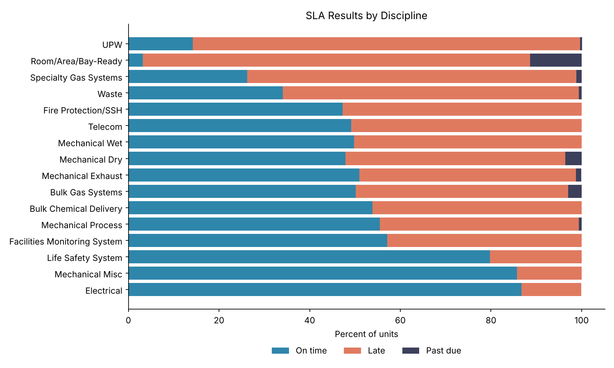
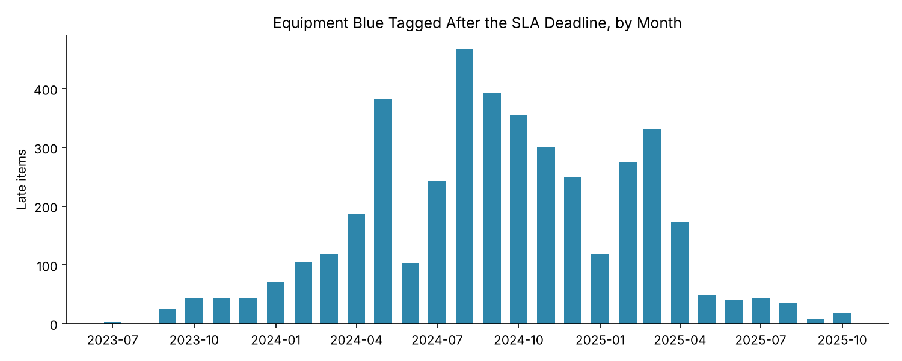

# Commissioning SLA Analysis

Tracking 10,693 pieces of equipment against a 5 business day commissioning SLA, built in Python from a real project tag log.



## The problem

On a large facility commissioning project, every piece of equipment gets two tags:

- **Green Tag:** the unit passed its initial inspection
- **Blue Tag:** the unit is fully commissioned and handed over

The team had a 5 business day SLA to get from Green Tag to Blue Tag. Tracking was done in a spreadsheet, so it was hard to see which items were slipping, how often it happened, and which trades were behind. I rebuilt that tracking in Python so it can be rerun on any new export and gives the same answer every time.

## What I found

- **10,693 units** from 21,383 tag records
- **59.2% Blue Tagged on time**, 39.5% late, and 1.3% (137 units) still past due at the end of the export
- **Median turnaround was 5 days**, right at the SLA line, so small slips pushed a lot of units over
- **Discipline made the biggest difference.** Electrical, the largest group at 3,202 units, was 87% on time. UPW and Room/Area/Bay-Ready were both about 85% late, and Room/Area/Bay-Ready also had the most items stuck past due
- **Late items peaked in August 2024** at 467 units, rose again in early 2025, then dropped off
- **Past due items piled up in March 2025**, which is when follow-up was needed most
- **Rebuilding it in Python caught a bug in my original Excel tracker.** Both versions matched on 10,684 units. The 3 that didn't had a Blue Tag but no Green Tag, and the Excel formula scored them On Time even though they never had a deadline



## How it works

1. **Mask the data** (`mask_data.py`): give each unit a random ID and keep only discipline and tag dates
2. **Roll up** the tag log to one row per unit, using the latest Green and Blue tag dates
3. **Set the deadline** to the Green Tag date plus 5 business days
4. **Assign an SLA status:**
   - **On Time:** Blue Tag on or before the deadline
   - **Late:** Blue Tag after the deadline
   - **Past Due:** no Blue Tag and the deadline has passed
5. **Break it down** by month and by discipline, then chart the results
6. **Check it** against the original Excel pivot and explain every difference
7. **Rebuild the tracker in Excel** with the bug fixed (`excel/commissioning_sla_tracker.xlsx`). It uses WORKDAY for deadlines and COUNTIFS for the summary, and it matches Python exactly

Statuses are checked against a fixed "as of" date (the last date in the export) instead of today's date, so rerunning the notebook doesn't change the results.

## Tools

| Tool | Used for |
|------|----------|
| Python (pandas) | Masking, cleaning, roll up, and SLA logic |
| Matplotlib | Charts in this README |
| Plotly | Interactive chart |
| Excel (WORKDAY, COUNTIFS) | Formula version of the tracker, matches the Python results |

## Files

```
commissioning-sla-analysis/
├── commissioning_sla_analysis.ipynb   Full analysis
├── mask_data.py                       Masks the private export before analysis
├── excel/
│   └── commissioning_sla_tracker.xlsx Formula version with summary and discipline tabs
├── images/                            Charts
└── output/
    ├── sla_summary.csv                Counts and percent by status
    ├── sla_by_discipline.csv
    ├── late_by_month.csv
    ├── past_due_by_month.csv
    └── late_by_month.html             Interactive chart
```

## Data and confidentiality

The tag log came from a real project. The only data published here is the masked version inside the Excel tracker: random unit IDs, discipline, and tag dates, with no names, locations, or project details. To rerun it, run `mask_data.py` on an export with the same columns, then open the notebook.

## Limitations

- Business days skip weekends but not holidays.
- The masked file only keeps discipline and dates, so the analysis stops at the discipline level.

## What I'd add next

- Add a holiday calendar to the deadline math
- Dig into UPW and Room/Area/Bay-Ready to find what was holding them up
- Schedule the export so the report updates on its own
